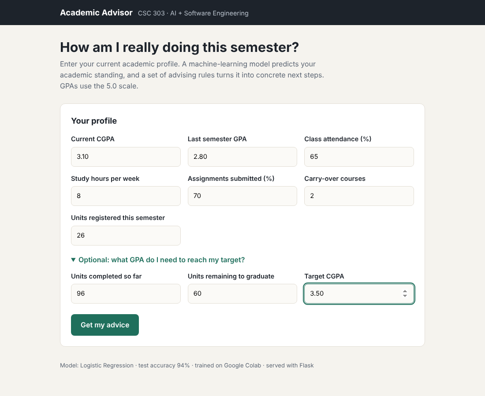
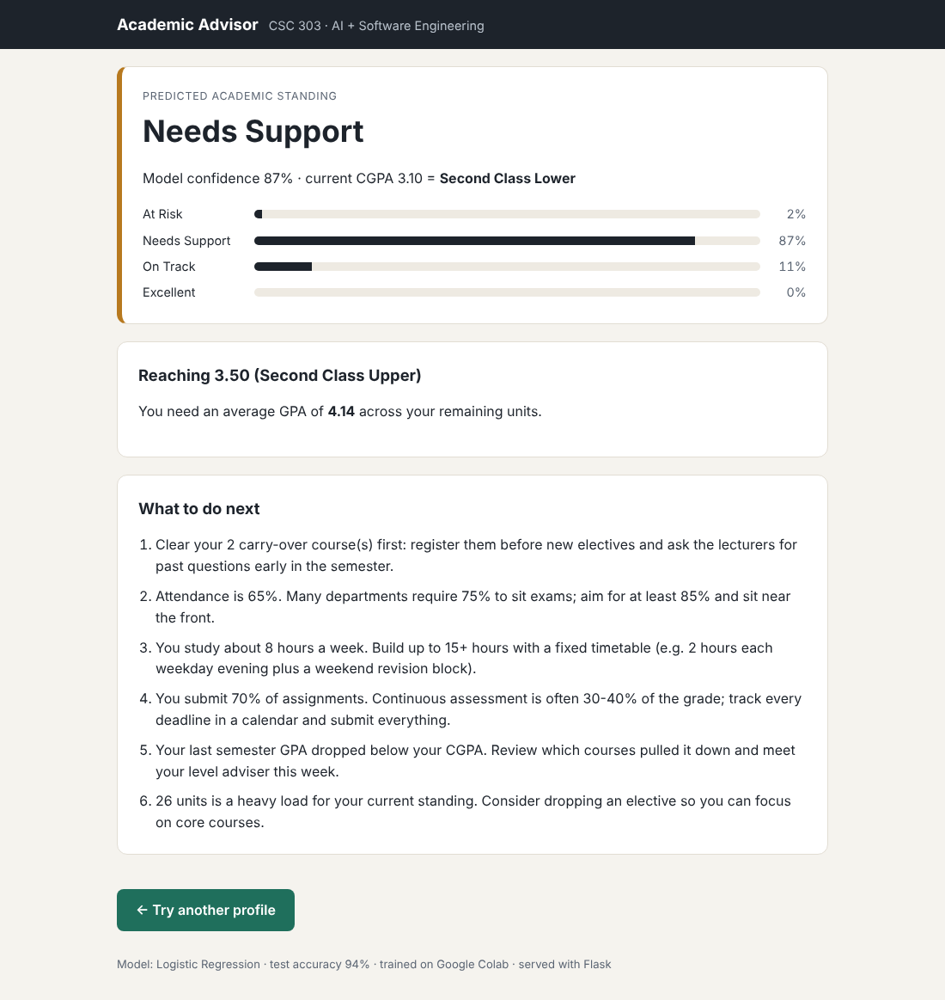
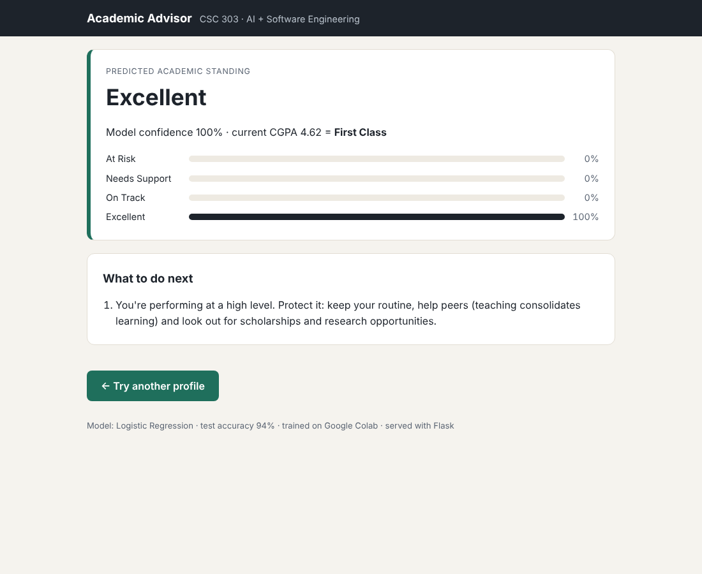

# AI Academic Advisor — CSC 303 Assignment

A personal academic advisor that combines **standard software engineering practices** with an
**AI technique** (supervised machine learning). You enter your academic profile; a model trained on
Google Colab predicts your academic standing, and a rule engine turns that into concrete advice.


## Assignment checklist

| Requirement | Where it is in this project |
|---|---|
| Git installed | Project is a Git repository with a full commit history (`git log`) |
| GitHub installed | Pushed to GitHub with GitHub Desktop / Git (steps below) |
| Create a repo | This repository |
| Python-optimised VS Code | `.vscode/settings.json`, `extensions.json`, `launch.json` (Python, Pylance, Black, Jupyter, pytest, Flask debug) |
| Model built on Google Colab | `notebooks/academic_advisor_colab.ipynb` |
| `.pkl` deployed with a suitable framework | `model/advisor_model.pkl` served by **Flask** in `app.py` |
| Tested on a web application | Browser UI at `/`, JSON API at `/api/advise`, automated tests in `tests/` |

## How it works

```
 Google Colab                     This repo (VS Code)
 ┌────────────────────────┐       ┌──────────────────────────────────────────┐
 │ generate 2,000 student │       │ Flask app (app.py)                       │
 │ records → explore →    │ .pkl  │   ├─ advisor/engine.py                   │
 │ train 3 models → pick  │──────▶│   │   ├─ ML model  → predicted standing  │
 │ best → advisor_model   │       │   │   └─ rules     → advice + target GPA │
 │ .pkl                   │       │   └─ templates/ (web UI), /api/advise    │
 └────────────────────────┘       └──────────────────────────────────────────┘
```

**AI part.** A classifier predicts one of four standings — `Excellent`, `On Track`,
`Needs Support`, `At Risk` — from seven features: CGPA, last semester GPA, attendance %, weekly
study hours, assignment submission %, carry-over courses and units registered (Nigerian 5.0 scale).
The notebook compares Logistic Regression, Decision Tree and Random Forest with 5-fold
cross-validation and keeps the best. Current model: **Logistic Regression, 94% test accuracy**.

**Software-engineering part.** Input validation, explainable rule-based recommendations, a
class-of-degree lookup, a "GPA needed to reach my target" calculator, a JSON API, 22 automated
tests, version-controlled code and a shared VS Code configuration.

## Project structure

```
├── advisor/engine.py          # model loading, validation, rules, GPA calculator
├── app.py                     # Flask web app + JSON API
├── templates/, static/        # web interface
├── model/advisor_model.pkl    # trained model bundle
├── notebooks/academic_advisor_colab.ipynb   # training notebook (Google Colab)
├── data/student_records.csv   # dataset produced by the notebook
├── tests/test_advisor.py      # pytest suite
└── .vscode/                   # Python-optimised VS Code setup
```

## Run it (Windows)

```powershell
git clone https://github.com/boluwatitofolorunsho603-source/csc303-academic-advisor.git
cd csc303-academic-advisor
python -m venv .venv
.venv\Scripts\activate
pip install -r requirements.txt
python app.py
```

Open http://127.0.0.1:5000 in your browser. (macOS/Linux: `source .venv/bin/activate`.)

Run the tests:

```powershell
pytest -v
```

In VS Code you can also press **F5 → "Run Flask app"**, or use the Testing panel.

## Retrain the model on Google Colab

1. Go to https://colab.research.google.com → **File → Upload notebook** → choose
   `notebooks/academic_advisor_colab.ipynb`.
2. **Runtime → Run all.** The last cell downloads `advisor_model.pkl`.
3. Replace `model/advisor_model.pkl` with the downloaded file.
4. Cell 1 prints the scikit-learn version Colab used. Install the same version locally so the
   pickle loads cleanly: `pip install scikit-learn==<that version>`.

## API example

```bash
curl -X POST http://127.0.0.1:5000/api/advise -H "Content-Type: application/json" -d "{\"cgpa\":3.1,\"last_gpa\":2.8,\"attendance\":65,\"study_hours\":8,\"assignment_rate\":70,\"carryovers\":2,\"course_units\":26}"
```

Returns the predicted standing, class probabilities, class of degree and recommendations.

## Screenshots — tested on the web app

| Input form | Advice for a struggling student | Advice for a strong student |
|---|---|---|
|  |  |  |

## Limitations

The training data is synthetic (real student records are private), so the model reflects the
patterns built into the generator rather than a real department. Swapping in real anonymised
records only needs changes to the dataset cell of the notebook.
